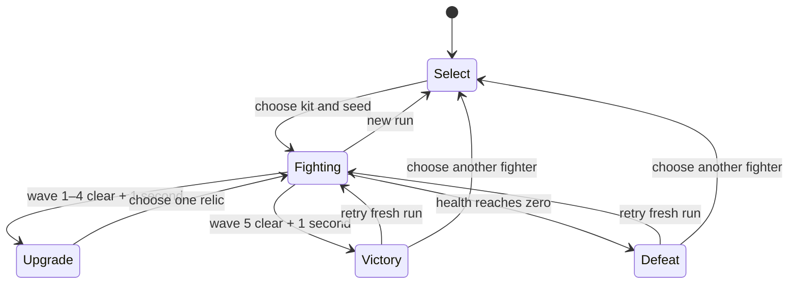

# Gameplay and presentation boundaries

`GameLoop` accumulates elapsed time into fixed 1/60-second ticks, capped at 15 catch-up steps. It records discarded stall time. Simulation state is rendered without interpolation. Pause resets the accumulator and wall-clock timestamp so returning to a hidden tab does not simulate missed combat.

`Simulation` owns a `Player`, `EnemyStore`, `SpatialGrid`, `CombatSystem`, `CrowdSystem` and field pickup records. Each tick handles movement/dodge, enemy timers, grid rebuild, bomb input, combat/projectiles and AI. All positions are kinematic and clamped to the arena. No DOM, Babylon types, wall clock or unseeded randomness enters these modules.

`CombatSystem` owns per-swing hit IDs, cast impact gating and arrow records. Each arrow stores previous position, velocity, remaining life, hit IDs and remaining penetrations. A swept segment queries a bounding circle in the spatial grid, projects candidate enemy centers onto the segment, rejects candidates beyond the 0.65-unit collision radius, then resolves hits in first collision-surface order (ID breaks ties). This avoids tunneling at fixed ticks and duplicate hits across ticks. Death and cooldown checks gate new attacks. Kit-specific special origins lock at cast time; exactly one impact resolves. `applyHit` centralizes armor-adjusted caller damage, stat multipliers, hit feedback, stagger/knockback, kills, charge and kill healing.

`EnemyStore` provides seeded spawning and optional five-second returns. `CrowdSystem` owns pursuit, windup, attack, stagger and dead states, local separation and role behavior. `SpatialGrid` excludes dead enemies on rebuild and performs exact circular filtering over candidate cells. Combat also checks current death state because multiple actions can share a rebuilt grid in one tick.

`RunDirector` wraps the existing simulation, leaving benchmark/practice behavior independent. It disables respawns, creates finite waves, claims each death once, emits deterministic drops, handles pickup caps/proximity, and freezes at choices or terminal states. Death takes priority over wave clear. A one-second clear delay lets effects finish, then all remaining drops are collected (excess capped supplies discarded). One valid relic selection applies once, heals 20 and starts the next wave at a safe distance. Kills, health and stat bonuses carry; projectiles/combos clear. A restart creates a fresh player, inventory, reward counter and build. Relic sampling shuffles a kit-appropriate pool with a seeded LCG derived from run seed and wave. Field drop types follow the documented defeat-count schedule; seed changes positions and relics, not item cadence.

`InputManager` samples keyboard and gamepad at tick boundaries. Attacks are edges for melee, held for Ranger; special, dodge, bomb and restart are discrete edges. Ranger movement preserves facing while attacking. Menu input is handled in the browser coordinator because the simulation is frozen there. The initial seed defaults to 4242 or the validated URL parameter; an explicit New seed action draws a new seed using browser crypto and updates the URL. Retries preserve it.

`Renderer` defines the backend interface. `BabylonRenderer` uses modular ES imports and built-in materials, selecting WebGPU with fallback. It reads state only: body meshes, telegraphs, health bars, bow/blade, arrow meshes, color-coded drops, bomb ring and kit-specific special effects. Arrow/drop presentation pools grow to the peak visible count and reuse meshes afterward. Reduced motion changes presentation only. `AudioFeedback` observes counters and health; `main.ts` owns menus, focus, HUD, pause and browser lifecycle.

`BenchmarkRunner` creates its own seeded `Simulation` without a `RunDirector`, suspending interactive play. Melee and ranged workloads have different scenario IDs. Requested actors stay alive for valid 0/20/100/300 comparisons. Measurements include rendering and collision work but intentionally exclude field rewards and relic decisions. Prototype debug hooks expose state for controlled browser fixtures; they are not a persistence or networking API.
